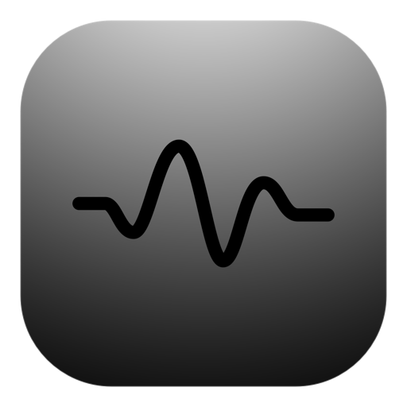

# StayOn

<p align="center">
  
</p>

<p align="center">
  <a href="https://github.com/unamatasanatarai/stayon/releases/latest">
    
  </a>
</p>

<p align="center">
  <strong>Keep your Mac awake when it matters most — with a single click from the menu bar.</strong>
</p>

<p align="center">
  <a href="https://swift.org"></a>
  <a href="https://www.apple.com/macos/"></a>
  <a href="LICENSE"></a>
  
</p>

StayOn is a lightweight, native macOS menu bar utility that prevents system idle sleep indefinitely or for a precision duration. Built exclusively for the menu bar with zero Dock clutter, zero windows, and zero background overhead, it lets you maintain uninterrupted workflows during presentations, large file transfers, renders, and compile jobs without changing your system-wide energy settings.

---

## Why StayOn

macOS sleep timers protect your battery and display, but they often kick in at the worst possible moments: halfway through a screen share, during an overnight dataset download, or in the middle of a lengthy build. Adjusting Energy Saver settings in System Settings requires digging through menus and invariably leads to forgetting to turn sleep back on.

StayOn solves this with a lightweight, temporary override right in your menu bar:

* **Instant Control**: Left-click to immediately activate indefinite sleep prevention; left-click again to release it.
* **Fire-and-Forget Timers**: Right-click to pick a duration from 5 minutes to 4 hours. StayOn keeps your system awake and automatically returns macOS to normal sleep management the moment the timer elapses.
* **Native System Assertions**: Uses Apple's official `ProcessInfo` activity assertions rather than generating synthetic keystrokes or mouse wiggles. Your screen can still turn off safely, and no lingering locks remain if the app closes.

---

## Key Capabilities

### Instant One-Click Toggle
Left-click the status bar icon to toggle indefinite sleep prevention immediately. The icon instantly transitions between an active heartbeat pulse and an inactive flatline.

### Eight Predefined Timers
Choose from standard durations tailored to real workflows:
* **Short Tasks**: 5, 10, 15 minutes
* **Standard Sessions**: 30, 45 minutes
* **Extended Operations**: 1, 2, 4 hours

Selecting a new duration resets the countdown immediately without compounding or competing with existing timers.

### Real-Time Expiration Tracking
The top menu item calculates remaining time directly against an absolute deadline timestamp. It provides continuous live feedback (`Active — 23 minutes left` down to `Active — Less than 1 minute left`) and acts as a quick deactivation button with a single click.

### Adaptive Menu Bar States
Custom vector-rendered status bar icons seamlessly adapt to both Light Mode and Dark Mode:
* **Active**: Rounded rectangle with an energized pulse waveform (`pulse-on`).
* **Inactive**: Rounded rectangle with a calm flatline (`pulse-off`).
* **Theme-Aware**: Renders a high-contrast dark badge with white line in Light Mode, and a crisp light badge with dark line in Dark Mode.

### Persistent Controls & Options
Includes native, visible checkbox toggles for your environment:
* **Start at Login**: Registers StayOn to start when your Mac boots (using `SMAppService` on macOS 13+ and a per-user LaunchAgent on macOS 12).
* **Activate on Launch**: Automatically enables indefinite sleep prevention every time the app opens.
* **Prevent Logout**: Keeps display awake and periodically declares user activity via native IOKit assertions (`IOPMAssertionDeclareUserActivity`), suppressing inactivity logouts and lock screens just like Caffeine without requiring Accessibility permissions.

---

## How It Works

```text
  [ Left-Click ] ──────────────► Toggle Indefinite Awake State
                                 (Immediate Assertion / Release)

  [ Right-Click ] ─────────────► Native Context Menu
                                  ├── Dynamic Status & One-Click Deactivation
                                  ├── 8 Precision Timers (5m – 4h)
                                  ├── ☑ Start at Login
                                  ├── ☑ Activate on Launch
                                  ├── ☑ Prevent Logout
                                  └── Quit StayOn
```

1. **Activate**: Left-click the menu bar icon for indefinite mode, or right-click and pick a duration.
2. **Assertion Held**: StayOn holds unified `ProcessInfo` sleep assertions (`idleSystemSleepDisabled` and optionally `idleDisplaySleepDisabled`) alongside native IOKit user activity heartbeat declarations when Prevent Logout is enabled.
3. **Auto-Expiration**: When a timer concludes, StayOn automatically releases the assertion and returns the icon to inactive with zero user intervention required.

---

## What Makes It Different

* **True Menu Bar Citizen (`LSUIElement = true`)**: No Dock icon, no command center window, and no application switcher footprint.
* **Zero Accessibility Permissions**: Works just like Caffeine, preventing system sleep, display sleep, and automatic inactivity logouts without simulated mouse/keyboard events or invasive macOS Accessibility permissions.
* **Deterministic Assertion Lifecycle**: Exactly one system assertion is held at any time. Switching between indefinite and timed modes reuses the active assertion without churn, and deactivation, expiration, or quitting releases it instantly.
* **Zero Dependencies**: Pure Swift and AppKit. No Electron, no Node runtime, no external package dependencies.

---

## Quick Start

### Build and Launch

Compile the standalone `.app` bundle and run it immediately:

```bash
make run
```

### Build Distribution DMG

Package the app into a drag-and-drop macOS disk image with custom background styling:

```bash
make dmg
```

The resulting distribution disk image is saved to `build/StayOn-1.0.0.dmg`.

---

## Development & Makefile Targets

StayOn includes a zero-dependency build system using standard macOS developer tools:

| Target | Description |
|---|---|
| `make build` | Compile the `.app` bundle into `build/StayOn.app` with ad-hoc code signing |
| `make run` | Terminate running instances, rebuild bundle, and launch `StayOn.app` |
| `make test` | Compile and execute the native Swift unit test suite |
| `make dmg` | Create styled, distribution-ready disk image (`build/StayOn-<version>.dmg`) |
| `make kill` | Terminate all running `StayOn` processes cleanly |
| `make revoke` | Reset permissions and flush macOS LaunchServices and QuickLook caches |
| `make clean` | Remove `build/` directory and temporary artifacts |

---

## Testing & Quality

StayOn includes a native, standalone Swift test suite that executes directly via `make test` without requiring Xcode GUI test harnesses:

```bash
make test
```

The suite covers:
* **State Machine Transitions**: Validates transitions across Inactive, Active Indefinite, and Active Timed states.
* **Deadline Calculations**: Verifies remaining time calculations, rounding thresholds, and status text formatting across all boundary conditions.
* **Assertion Management**: Confirms single-assertion guarantees, reuse across duration switches, and complete release on timer expiration or quit.
* **Preferences & Persistence**: Verifies `UserDefaults` persistence, login item registration workflows, and launch state synchronization.
* **Menu Structure**: Validates exact menu item hierarchy, tags, separators, keyboard shortcuts, and visible checkbox states.

---

## Requirements

* **Operating System**: macOS 12.0 (Monterey) or later
* **Architecture**: Universal (Apple Silicon & Intel)
* **Build Tooling**: Command Line Tools for Xcode (`swiftc`, `codesign`, `iconutil`)

---

## License

This project is licensed under the [GNU General Public License v2.0](LICENSE).
